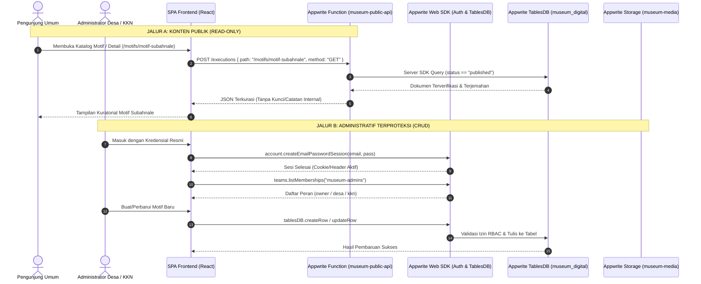

# Spesifikasi Integrasi API (API Integration Specification)
## Museum Digital Pringgasela Selatan
**Panduan Komunikasi Data Klien Web & Appwrite Backend**

---

### 1. Model Komunikasi Ganda (*Dual-Channel Gateway*)

Aplikasi Museum Digital Pringgasela Selatan membagi seluruh arus komunikasi data menjadi dua jalur yang sepenuhnya terpisah demi menegakkan prinsip keamanan mutlak (*zero-trust security*):



---

### 2. Konfigurasi Klien Appwrite (`src/appwrite/config.ts`)

Semua konstanta lingkungan klien didefinisikan secara transparan tanpa mengandung rahasia apa pun:

```typescript
export const APPWRITE_CONFIG = {
  endpoint: 'https://sgp.cloud.appwrite.io/v1',
  projectId: '6affdaa0003c416ecdb0',
  databaseId: 'museum_digital',
  mediaBucketId: 'museum-media',
  adminTeamId: 'museum-admins',
  publicApiFunctionId: 'museum-public-api',
};
```

---

### 3. Jalur A: Public Content API Gateway (`src/appwrite/publicApi.ts`)

Pengunjung umum memanggil fungsi Appwrite melalui `functions.createExecution` dengan metode `GET` dan jalur yang diinginkan. Respons dari fungsi dieksekusi secara instan dan dikembalikan sebagai JSON berstruktur rapi:

#### Rute API Publik yang Tersedia:

1. **`GET /crafts`**
   - **Parameter:** `limit` (default: 20), `offset` (default: 0), `categoryId` (opsional)
   - **Deskripsi:** Mengambil daftar kriya budaya berstatus `published` beserta terjemahan bahasa aktif.
   - **Contoh Respons:**
     ```json
     {
       "total": 2,
       "limit": 20,
       "offset": 0,
       "items": [
         {
           "$id": "craft-tenun-pringgasela",
           "slug": "tenun-gedogan-pringgasela",
           "categoryId": "cat-tenun",
           "isFeatured": true,
           "translations": [...]
         }
       ]
     }
     ```

2. **`GET /crafts/:slug`**
   - **Deskripsi:** Mengambil detail lengkap satu kriya budaya berdasarkan slug URL unik, termasuk relasi kontributor dan daftar media terkait.

3. **`GET /motifs`**
   - **Parameter:** `limit` (default: 20), `offset` (default: 0), `categoryId` (opsional), `featured` (opsional)
   - **Deskripsi:** Mengambil koleksi ensiklopedia motif tenun tradisional berstatus `published`.

4. **`GET /motifs/:slug`**
   - **Deskripsi:** Mengambil satu motif tenun secara komprehensif, mencakup:
     - Data morfologi visual (`visualDescription`)
     - Filosofi dan makna spiritual (`philosophy`)
     - Teknik tenun dan pakan-lungsi (`technique`)
     - Penggunaan adat dan daur hidup (`historicalUsage`)
     - Cerita asal-usul dan tutur lisan (`originStory`)
     - Atribusi tokoh adat / penenun (`contributor`)
     - Galeri foto dan ilustrasi motif (`media`)

5. **`GET /cultures` & `GET /cultures/:slug`**
   - **Deskripsi:** Mengambil tradisi komunal dan kesenian sakral (seperti Dzikir Saman Pringgasela) beserta prosedur ritual dan nilai spiritualnya.

6. **`GET /history`**
   - **Deskripsi:** Mengambil urutan kronologis babak sejarah desa (*historical eras*) yang diurutkan berdasarkan `sortOrder` dan tahun awal (`startYear`).

7. **`GET /settings`**
   - **Deskripsi:** Mengambil pengaturan institusional museum (nama resmi, kontak desa, sambutan kepala desa).

---

### 4. Jalur B: Integrasi Operasi Administratif (Admin CMS SDK)

Untuk pengguna terotentikasi di dalam tim `museum-admins`, operasi dilakukan melalui pustaka `appwrite` TablesDB dan Storage:

#### A. Operasi TablesDB
```typescript
import { tablesDB } from '../appwrite/client';
import { APPWRITE_CONFIG } from '../appwrite/config';

// 1. Mengambil data untuk tabel admin (draf maupun terbit)
const res = await tablesDB.listRows(
  APPWRITE_CONFIG.databaseId,
  'weaving_motifs',
  [Query.orderDesc('$createdAt'), Query.limit(50)]
);

// 2. Menyimpan draf dokumentasi baru
const newMotif = await tablesDB.createRow(
  APPWRITE_CONFIG.databaseId,
  'weaving_motifs',
  ID.unique(),
  {
    slug: 'motif-sari-menanti',
    codeName: 'SMN-02',
    categoryId: 'cat-tenun',
    publicationStatus: 'draft',
    isFeatured: false,
    contributorId: 'contrib-mariam'
  }
);

// 3. Menyimpan terjemahan dwibahasa (Indonesian & English)
await tablesDB.createRow(
  APPWRITE_CONFIG.databaseId,
  'motif_translations',
  ID.unique(),
  {
    motifId: newMotif.$id,
    locale: 'id',
    name: 'Motif Sari Menanti',
    philosophy: 'Melambangkan kesabaran dan harapan luhur...'
  }
);
```

#### B. Integrasi Penyimpanan Berkas (`Appwrite Storage`)
```typescript
import { storage } from '../appwrite/client';
import { APPWRITE_CONFIG } from '../appwrite/config';
import { Permission, Role } from 'appwrite';

// Pengunggahan berkas media berkeamanan berkas (File-Level Security)
const uploadResult = await storage.createFile(
  APPWRITE_CONFIG.mediaBucketId,
  ID.unique(),
  file,
  [
    Permission.read(Role.any()), // Hak baca publik untuk aset terkurasi
    Permission.update(Role.team(APPWRITE_CONFIG.adminTeamId)),
    Permission.delete(Role.team(APPWRITE_CONFIG.adminTeamId, 'owner'))
  ],
  undefined,
  (progress) => {
    const percent = Math.round((progress.progress / progress.total) * 100);
    console.log(`Unggah berkas: ${percent}%`);
  }
);
```

---

### 5. Penanganan Galat & Ketahanan Sistem (*Resilience & Error Handling*)

1. **Galat Jaringan atau Layanan Tak Tersedia (500/503):** Ditangkap oleh blok `try...catch` dan diteruskan ke komponen `<ErrorState />` dengan tombol coba ulang (*retry action*).
2. **Entitas Tidak Ditemukan (404):** Dialihkan ke tampilan status kosong kuratorial dengan tautan kembali ke katalog utama.
3. **Pelanggaran Izin RBAC (401/403):** Sesi kedaluwarsa secara otomatis menghapus state lokal dan mengarahkan admin ke `/admin/login`. Mahasiswa KKN yang mencoba menghapus data permanen akan menerima pesan penolakan hak akses (*action restricted*).
4. **Fallback Gambar Digital:** Jika berkas gambar gagal dimuat dari server, utilitas `getFallbackImage` secara otomatis menghasilkan grafis vektor SVG bermotif tenun Pringgasela orisinal, memastikan tata letak katalog tidak pernah rusak atau menampilkan ikon gambar pecah.
