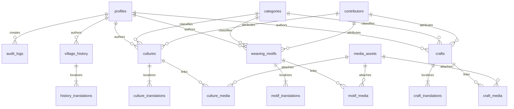
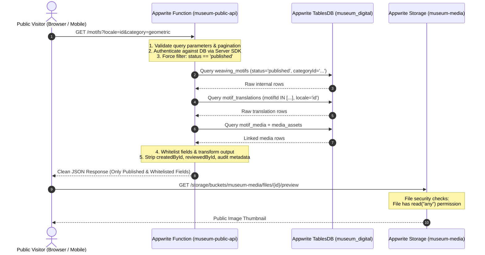
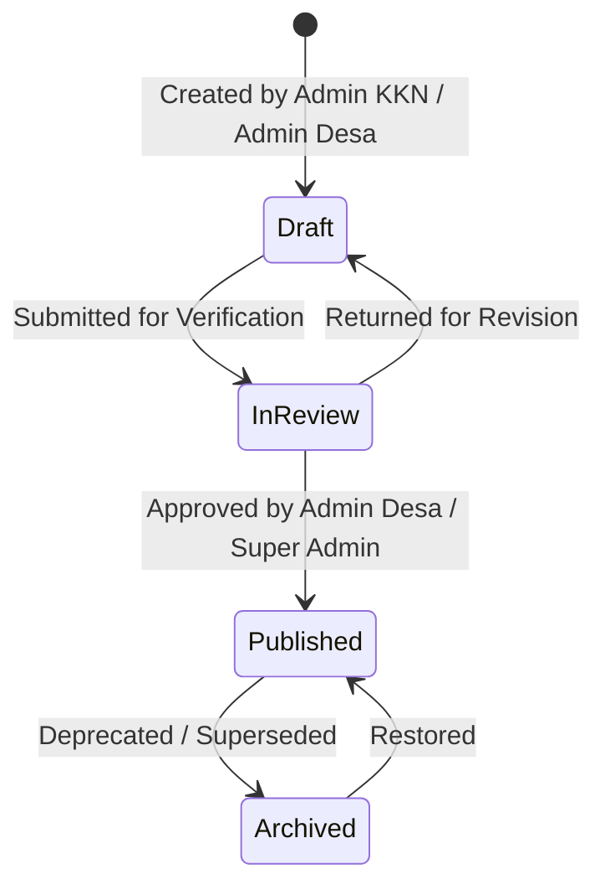

# DATABASE ARCHITECTURE
**Project:** Museum Digital Pringgasela Selatan  
**Database System:** Appwrite TablesDB  
**Primary Database ID:** `museum_digital`  
**Architecture Version:** 2.1.0 (Phase 2.1 Security & Free-Tier Hardened)  

---

## 1. Revision History & Phase 2.1 Corrections

> [!IMPORTANT]
> **Phase 2.1 Architecture Corrections Summary:**
> 1. **Zero Table-Level Public READ Permissions:** Eliminated all public `read("any")` permissions from internal TablesDB collections. Because Appwrite permissions are **additive and never restrictive**, table-level read access allows unauthenticated client queries to bypass status filters and inspect unpublished drafts.
> 2. **Serverless Public Gateway (`museum-public-api`):** All public visitors now query published heritage content through a dedicated Appwrite Function using the Server SDK. The function hardcodes `status == 'published'` filters and strictly whitelists public fields.
> 3. **Complete Weaving Motif Encyclopedia:** Upgraded `weaving_motifs` with `categoryId`, `contributorId`, and `reviewedById`, and upgraded `motif_translations` with `visualDescription` and `technique`.
> 4. **Storage Single-Bucket Consolidation:** Consolidated all storage into a single bucket `museum-media` with `fileSecurity: true` to adhere to the Appwrite Free Plan limit (1 bucket).

---

## 2. Architectural Principles

1. **Strict Private Core with Serverless Public Gateway:**  
   The TablesDB database is 100% private. Direct database connections are restricted to authenticated administrative staff (`Role.team("museum-admins")`). Public visitors access data exclusively through a single, controlled Appwrite Function (`museum-public-api`), guaranteeing that unverified drafts, internal notes, and administrative metadata cannot leak.
2. **Strict Multilingual Separation:**  
   Every cultural record separates its language-agnostic core entity (identifiers, slugs, publication status, dates, references) from its localized text (`*_translations`). This supports Indonesian (`id`) as the primary national language and English (`en`) for international academic and tourism reach.
3. **Referential Integrity & Normalization:**  
   Media assets, categories, and contributors are decoupled into reusable normalized entities connected via structured foreign keys and dedicated junction tables.
4. **Auditable Content Lifecycle:**  
   Every publishable record tracks a state machine (`draft` -> `in_review` -> `published` -> `archived`) with explicit attribution to author profile, cultural informant, and verifying village administrator.
5. **Idempotent Revocability for Student Teams (KKN):**  
   Contributions authored by temporary KKN administrators (`Admin KKN`) retain immutable author attribution even if the student's access credentials are subsequently revoked or deleted.

---

## 3. High-Level Entity Diagram

---

## 4. Public Content API Gateway Architecture

Because public visitors have **zero direct read access** to TablesDB tables, public reads are mediated by the `museum-public-api` Appwrite Function:

---

## 5. Core Domain Entities & Scope

### 5.1. Identity & System Operations
* **`profiles`**: Extends Appwrite Auth users (`$id`). Stores full name, role (`super_admin`, `admin_desa`, `admin_kkn`), avatar URL, organization/institution, and bio.
* **`audit_logs`**: Immutable ledger recording all administrative actions (create, update, publish, archive, delete) with timestamps, actor IDs, and payload diffs.
* **`museum_settings`**: Global configuration singleton storing village institutional metadata, museum contact info, active banners, and virtual tour configurations.

### 5.2. Taxonomies & Attribution
* **`categories`**: Hierarchical grouping for cultural assets (`craft`, `motif`, `culture`, `history`).
* **`contributors`**: Cultural custodians, weaving masters (penenun), community elders, informants, and research contributors providing oral history or physical craft samples.

### 5.3. Cultural Heritage Collections
* **`crafts` & `craft_translations`**: Master records for tangible craft heritage, with primary focus on **Tenun Pringgasela** (traditional backstrap weaving, natural dye traditions), **Batik Sasambo**, and traditional wood/bamboo crafts.
* **`weaving_motifs` & `motif_translations`**: Granular documentation of historical weaving patterns (e.g. *Sari Menanti*, *Bayan Duri*, *Reragigan*, *Pucuk Rebung*). Directly links to `categories` (category classification), `contributors` (artisan attribution), and `profiles` (reviewer verification), with translation fields for visual geometry and weaving techniques.
* **`cultures` & `culture_translations`**: Intangible cultural heritage, centering on **Dzikir Saman Pringgasela**, traditional lifecycle ceremonies (nyelabar, begawe), folk arts, and customary village ethics.
* **`village_history` & `history_translations`**: Chronicle of Pringgasela Selatan village, origin narratives, traditional leadership lineages, and historical milestones.

### 5.4. Centralized Digital Asset Management (DAM)
* **`media_assets`**: Reusable media catalog storing references to Appwrite Storage files (photos, high-resolution heritage scans, audio recordings of Saman chanting, video interviews).
* **Junction Tables (`craft_media`, `motif_media`, `culture_media`)**: Enables many-to-many associations between cultural entities and media assets with sort orders, cover flags, and specific roles (`hero`, `technique`, `detail`, `audio_sample`).

---

## 6. Content Lifecycle & Workflow

* **`draft`**: Visible strictly to authenticated administrative staff (`museum-admins`).
* **`in_review`**: Locked for review by Village Administrators or Cultural Custodians.
* **`published`**: Accessible to public visitors through the `museum-public-api` gateway.
* **`archived`**: Hidden from public API responses, preserved for archival integrity.
