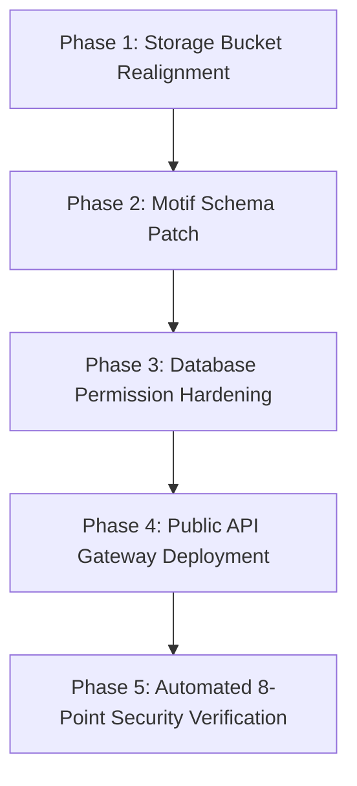

# FINAL DEPLOYMENT CHECKLIST & ROLLOUT SPECIFICATION
**Project:** Museum Digital Pringgasela Selatan  
**Database ID:** `museum_digital` (Appwrite Cloud / `sgp`)  
**Project ID:** `6affdaa0003c416ecdb0`  
**Document Version:** 2.1.0 (Phase 2.1 Security & Free-Tier Production Rollout)  
**Date:** 2026-11-24  

---

## 1. Revision History & Phase 2.1 Corrections

> [!IMPORTANT]
> **Phase 2.1 Deployment Plan Corrections Summary:**
> 1. **Zero Direct Public Database Access:** Updated deployment steps to verify that no content table carries public table-level read permissions.
> 2. **Appwrite Function Deployment (`museum-public-api`):** Added the public gateway function deployment within the 2-function project limit.
> 3. **Single Bucket Consolidation:** Configured deployment verification for `museum-media` with file-level security active.
> 4. **Motif Encyclopedia Schema Patch:** Explicitly staged non-destructive column additions for `weaving_motifs` and `motif_translations`.
> 5. **Automated 8-Point Security Verification Suite:** Integrated executable smoke tests prior to public handover.

---

## 2. Pre-Deployment Readiness Matrix

| Component | Target Architecture | Current Cloud Status | Rollout Action Required Upon Approval |
| :--- | :--- | :---: | :--- |
| **Authentication** | Connected (`abhyy333@gmail.com`) | **VERIFIED** | None |
| **Project Name** | Museum Digital Pringgasela Selatan | **VERIFIED** | None |
| **RBAC Team** | `museum-admins` (`owner`, `desa`, `kkn`) | **VERIFIED** | None |
| **Storage Bucket** | `museum-media` (`fileSecurity: true`) | Renamed / Active | Update bucket ID/name to `museum-media` |
| **Database** | `museum_digital` | **VERIFIED** | None |
| **17 Core Tables** | Private Containers Created | **VERIFIED** | Apply Schema & Permission Amendments below |
| **Table Permissions** | **Zero Public Read (Staff Only)** | Table-level read present | Strip `read("any")` from content tables |
| **Motif Attributes** | `categoryId`, `contributorId`, `reviewedById` | Missing | Add columns via non-destructive CLI command |
| **Translation Attributes**| `visualDescription`, `technique` | Missing | Add `mediumtext` columns to `motif_translations` |
| **Public API Gateway** | Function: `museum-public-api` | Not Deployed | Deploy serverless public API gateway |

---

## 3. Staged Non-Destructive Deployment Schedule

Once explicit deployment authorization is received, execution will proceed through four automated, non-destructive phases:



### Phase 1: Storage Configuration
* **Target:** Bucket `museum-media`
* **Command:**
  ```bash
  appwrite storage update-bucket \
    --bucket-id "museum-public" \
    --name "museum-media" \
    --file-security=true \
    --permissions 'create("team:museum-admins")' \
    --permissions 'update("team:museum-admins/desa")' \
    --permissions 'update("team:museum-admins/owner")' \
    --permissions 'delete("team:museum-admins/owner")'
  ```

### Phase 2: Schema Enhancements (Weaving Motifs & Cultures)
* **Target:** `weaving_motifs`, `motif_translations`, `cultures`
* **Non-Destructive Additions:**
  1. Add `categoryId` to `weaving_motifs`:
     ```bash
     appwrite tablesdb create-string-column --database-id museum_digital --table-id weaving_motifs --key categoryId --size 36 --required=false
     appwrite tablesdb create-index --database-id museum_digital --table-id weaving_motifs --key idx_motifs_category --type key --columns categoryId
     ```
  2. Add `contributorId` to `weaving_motifs`:
     ```bash
     appwrite tablesdb create-string-column --database-id museum_digital --table-id weaving_motifs --key contributorId --size 36 --required=false
     appwrite tablesdb create-index --database-id museum_digital --table-id weaving_motifs --key idx_motifs_contributor --type key --columns contributorId
     ```
  3. Add `reviewedById` to `weaving_motifs`:
     ```bash
     appwrite tablesdb create-string-column --database-id museum_digital --table-id weaving_motifs --key reviewedById --size 36 --required=false
     ```
  4. Add `visualDescription` & `technique` to `motif_translations`:
     ```bash
     appwrite tablesdb create-mediumtext-column --database-id museum_digital --table-id motif_translations --key visualDescription --required=false
     appwrite tablesdb create-mediumtext-column --database-id museum_digital --table-id motif_translations --key technique --required=false
     ```
  5. Add `contributorId` to `cultures`:
     ```bash
     appwrite tablesdb create-string-column --database-id museum_digital --table-id cultures --key contributorId --size 36 --required=false
     appwrite tablesdb create-index --database-id museum_digital --table-id cultures --key idx_cultures_contributor --type key --columns contributorId
     ```

### Phase 3: TablesDB Access Control Hardening
* **Action:** Strip `read("any")` from all content tables. Re-apply staff-only table permissions:
  ```bash
  for t in crafts craft_translations weaving_motifs motif_translations cultures culture_translations village_history history_translations categories contributors media_assets craft_media motif_media culture_media; do
    appwrite tablesdb update-table \
      --database-id museum_digital \
      --table-id "$t" \
      --permissions 'read("team:museum-admins")' \
      --permissions 'create("team:museum-admins")' \
      --permissions 'update("team:museum-admins/desa")' \
      --permissions 'update("team:museum-admins/owner")' \
      --permissions 'delete("team:museum-admins/owner")'
  done
  ```

### Phase 4: Public API Gateway Deployment (`museum-public-api`)
* **Action:** Deploy the unified public API function (Node.js 20) with internal routes for `/crafts`, `/motifs`, `/cultures`, `/history`, and `/settings`.
* **Resource Budget Check:** Uses Function Slot 1 of 2. Leaves Slot 2 open for optional utilities.

---

## 4. Final Security Test Plan & Verification Suite

Execute the 8-point automated test suite to confirm absolute security and compliance:

| Test ID | Test Assertion | Expected Behavior | Verification Command / Check |
| :---: | :--- | :--- | :--- |
| **TEST 1** | Anonymous visitor cannot list internal draft rows | `HTTP 401 Unauthorized` | `curl -i -H "X-Appwrite-Project: $P" "$E/databases/museum_digital/collections/crafts/documents"` |
| **TEST 2** | Anonymous visitor can access published content via Public API | `HTTP 200 OK` (JSON) | `curl -i -X POST "$E/functions/museum-public-api/executions" -d '{"path":"/crafts"}'` |
| **TEST 3** | Anonymous visitor cannot retrieve drafts by guessing ID | `HTTP 401 / 404` | `curl -i -H "X-Appwrite-Project: $P" "$E/databases/museum_digital/collections/weaving_motifs/documents/test_id"` |
| **TEST 4** | Authenticated admin can manage authorized content | `HTTP 200 OK` | `appwrite tablesdb list-tables --database-id museum_digital` |
| **TEST 5** | Admin KKN account revocation preserves authored data | Static string intact | Verify `createdById` remains populated after membership deletion |
| **TEST 6** | Private archival files blocked for anonymous visitors | `HTTP 401 / 403` | `curl -i -H "X-Appwrite-Project: $P" "$E/storage/buckets/museum-media/files/draft_id/view"` |
| **TEST 7** | Explicitly published media viewable publicly | `HTTP 200 OK` (Image) | File preview URL renders valid WebP thumbnail with `read("any")` |
| **TEST 8** | Public API never exposes administrative fields | Fields stripped | Validate JSON payload excludes `createdById`, `reviewedById`, `changesJson` |

---

## 5. Formal Approval Gate

> [!IMPORTANT]
> All documentation and architectural corrections for **Phase 2.1** are complete. In strict adherence to your instructions, **no changes have been made to your Appwrite Cloud project during this turn.**
> 
> Please review the corrected specifications and provide explicit approval to proceed with deployment.
