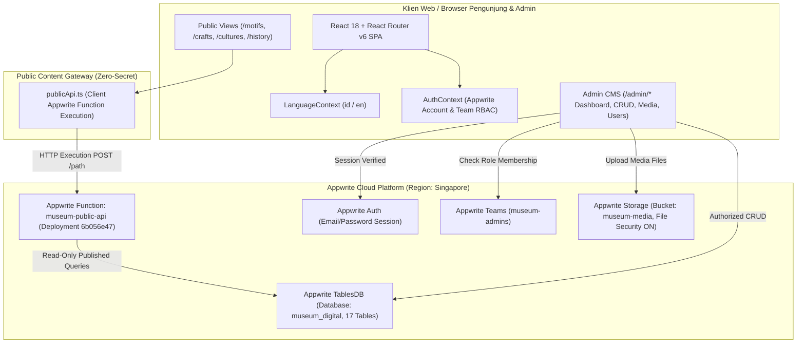

# Arsitektur Frontend & Sistem CMS
## Museum Digital Pringgasela Selatan
**Dokumen Teknis Tahap 4 (Phase 4 — Frontend Architecture Specification)**

---

### 1. Ringkasan Eksekutif & Prinsip Desain

Aplikasi Museum Digital Pringgasela Selatan dibangun sebagai antarmuka digital berbasis web (*Single Page Application* / SPA) yang menggabungkan:
1. **Museum Publik Berstandar Kuratorial Kontemporer:** Menampilkan warisan tekstil (Tenun Pringgasela, Batik Sasambo), ensiklopedia motif tenun, tradisi komunal sakral (Dzikir Saman), dan linimasa sejarah desa dengan dukungan dwibahasa (Indonesia - Inggris).
2. **Sistem Manajemen Konten (Admin CMS):** Antarmuka terkelola berbasis peran (*Role-Based Access Control* / RBAC) yang mengizinkan tim pemerintah desa dan mahasiswa KKN mendokumentasikan, mengedit, meninjau kurasi, serta menerbitkan artefak budaya secara langsung ke Appwrite Cloud Backend.

#### Prinsip Arsitektur Utama
- **Zero-Secret Client Security:** Frontend tidak pernah memuat Server SDK API Keys atau kredensial rahasia apa pun. Pengunjung umum mengakses konten hanya melalui *Public Content API Function* yang terisolasi (`museum-public-api`), sedangkan admin mengautentikasi diri melalui sesi akun Appwrite resmi (`appwrite.Account`).
- **Pemisahan Jalur Publik & Terproteksi:** Jalur publik (`/`, `/motifs`, `/crafts`, `/cultures`, `/history`, `/about`) terisolasi dari jalur administratif (`/admin/*`) yang dikunci dengan rute penjaga (*Protected Route Guard*).
- **Struktur Berorientasi Fitur (*Feature-Driven Modularity*):** Kode dikelompokkan berdasarkan domain fungsional (komponen publik, komponen admin, tata letak, konteks state, tipe schema, dan utilitas media).

---

### 2. Diagram Arsitektur Aplikasi



---

### 3. Struktur Direktori Proyek

```
/home/aby/Antigravity_Project/
├── public/
│   ├── favicon.svg             # Ikon favicon geometris tenun Pringgasela
│   ├── robots.txt              # Konfigurasi perayap mesin pencari
│   └── sitemap.xml             # Peta situs SEO bilingual
├── src/
│   ├── appwrite/
│   │   ├── config.ts           # Konstanta konfigurasi backend (Endpoint, Project, DB, Bucket)
│   │   ├── client.ts           # Inisialisasi resmi Appwrite Client (Account, TablesDB, Storage, Teams, Functions)
│   │   └── publicApi.ts        # Klien pemanggil Appwrite Function museum-public-api
│   ├── components/
│   │   ├── common/             # Komponen antarmuka atomik & tata letak global
│   │   │   ├── Badge.tsx       # Badge indikator status & kategori
│   │   │   ├── EmptyState.tsx  # Tampilan konten kosong
│   │   │   ├── ErrorState.tsx  # Tampilan penanganan galat jaringan/data
│   │   │   ├── Footer.tsx      # Kaki halaman institusional
│   │   │   ├── LoadingSpinner.tsx # Indikator pemuatan kuratorial
│   │   │   ├── Modal.tsx       # Dialog modal aksi & konfirmasi
│   │   │   └── Navbar.tsx      # Navigasi utama dengan pemilih bahasa & pencarian
│   │   ├── public/             # Kartu & elemen visual etalase publik
│   │   │   ├── CraftCard.tsx   # Kartu kriya tekstil & kerajinan
│   │   │   ├── CultureCard.tsx # Kartu tradisi & seni vokal Dzikir Saman
│   │   │   └── MotifCard.tsx   # Kartu ensiklopedia motif tenun
│   │   └── admin/              # Tata letak & komponen administratif
│   │       ├── AdminLayout.tsx # Sidebar navigasi, indikator peran, tombol logout
│   │       └── MediaUploader.tsx # Pengunggah berkas multimedia dengan progres & validasi
│   ├── context/
│   │   ├── AuthContext.tsx     # State autentikasi Appwrite, pemulihan sesi, RBAC
│   │   └── LanguageContext.tsx # Pengalih bahasa persisten (Bahasa Indonesia / English)
│   ├── pages/
│   │   ├── public/             # Halaman publik
│   │   │   ├── HomePage.tsx    # Beranda kuratorial, statistik budaya, sorotan motif
│   │   │   ├── MotifsPage.tsx  # Katalog ensiklopedia motif tenun tradisional
│   │   │   ├── MotifDetailPage.tsx # Dokumentasi mendalam morfologi, filosofi & tenun
│   │   │   ├── CraftsPage.tsx  # Katalog kriya Tenun Pringgasela & Batik Sasambo
│   │   │   ├── CraftDetailPage.tsx # Detail kriya & prosedur pembuatan
│   │   │   ├── CulturesPage.tsx # Direktori tradisi komunal & Dzikir Saman
│   │   │   ├── CultureDetailPage.tsx # Detail ritual, nilai spiritual & sastra lisan
│   │   │   ├── HistoryPage.tsx # Linimasa babak sejarah Desa Pringgasela Selatan
│   │   │   └── AboutPage.tsx   # Profil desa, visi-misi pelestarian & tata kelola
│   │   └── admin/              # Halaman panel kendali terproteksi
│   │       ├── AdminLoginPage.tsx # Halaman masuk kredensial Appwrite
│   │       ├── AdminDashboardPage.tsx # Metrik koleksi, draf, & log audit
│   │       ├── AdminMotifsPage.tsx # Manajemen CRUD motif tenun & terjemahan
│   │       ├── AdminCraftsPage.tsx # Manajemen CRUD kriya budaya & terjemahan
│   │       ├── AdminCulturesPage.tsx # Manajemen CRUD tradisi & seni pertunjukan
│   │       ├── AdminHistoryPage.tsx # Manajemen linimasa era sejarah desa
│   │       ├── AdminContributorsPage.tsx # Registri maestro penenun & tokoh adat
│   │       ├── AdminMediaPage.tsx # Pengelolaan repositori media terpusat
│   │       ├── AdminUsersPage.tsx # Visibilitas anggota tim admin & protokol KKN
│   │       └── AdminSettingsPage.tsx # Pengaturan metadata museum global
│   ├── types/
│   │   ├── schema.ts           # Definisi TypeScript 17 entitas TablesDB
│   │   └── api.ts              # Struktur respons typed Public Content API
│   ├── utils/
│   │   └── media.ts            # Pembentuk URL pratinjau Storage & pola SVG tenun
│   ├── App.tsx                 # Konfigurasi rute & rute penjaga otorisasi
│   ├── index.css               # Utilitas Tailwind CSS & tipografi serif museum
│   └── main.tsx                # Titik masuk React 18 DOM
├── index.html                  # Dokumen HTML utama dengan Google Fonts
├── package.json                # Dependensi proyek
├── postcss.config.js           # Konfigurasi PostCSS Tailwind
├── tailwind.config.js          # Palet warna kuratorial & tipografi budaya
├── tsconfig.json               # Konfigurasi TypeScript modern
└── vite.config.ts              # Konfigurasi bundler Vite dengan pemisahan chunk
```

---

### 4. Strategi Pengelolaan State (*State Management Strategy*)

1. **State Bahasa (`LanguageContext`):**
   - Mendukung dua bahasa: `id` (Bahasa Indonesia) dan `en` (English).
   - Menyimpan preferensi pilihan bahasa di `localStorage` peramban (`museum_lang`).
   - Menyediakan fungsi utilitas `t(idText, enText)` untuk kemudahan alih bahasa instan pada seluruh komponen visual.

2. **State Autentikasi & RBAC (`AuthContext`):**
   - Memulihkan sesi saat peramban dimuat ulang melalui `account.get()`.
   - Mengambil peran aktif pengguna pada tim `museum-admins` melalui `teams.listMemberships(APPWRITE_CONFIG.adminTeamId)`.
   - Menetapkan tiga peran administratif hierarkis:
     - `super_admin`: Pemilik sistem / penanggung jawab penuh, berhak menghapus data dan mengelola pengaturan global.
     - `admin_desa`: Aparatur desa, berhak meninjau, menyunting, dan menerbitkan draf konten ke status publik (*published*).
     - `admin_kkn`: Mahasiswa pengabdi / kontributor lapangan, berhak menginput draf dokumentasi dan mengunggah berkas media.
   - Menyediakan properti kenyamanan: `canPublish`, `canDelete`, `isSuperAdmin`.

3. **State Koleksi Data (*Server State*):**
   - Untuk pengunjung umum, data diperoleh dari `publicApi` dengan penanganan status asinkron standar (`loading`, `error`, `data`).
   - Untuk halaman admin, operasi baca-tulis memanfaatkan `tablesDB.listRows`, `tablesDB.createRow`, `tablesDB.updateRow`, dan `tablesDB.deleteRow` secara langsung dengan sesi klien aktif.

---

### 5. Keamanan Rute & Penjaga Akses (*Route Guarding*)

Komponen `ProtectedAdminRoute` di dalam `src/App.tsx` menerapkan verifikasi dua lapis:
1. **Pemeriksaan Sesi Aktif:** Mengarahkan pengguna anonim ke halaman `/admin/login`.
2. **Pemeriksaan Keanggotaan Tim:** Jika pengguna memiliki akun Appwrite namun tidak terdaftar di tim `museum-admins`, sistem menampilkan peringatan akses ditolak dan mencegah perambanan ke panel kendali.

---

### 6. Optimasi Kinerja & Pemisahan Berkas (*Bundle Splitting*)

Konfigurasi Vite memecah bundel JavaScript agar tidak ada satu berkas pun yang membebani jaringan:
- `vendor`: Berisi inti React, ReactDOM, dan React Router (`163.43 kB`).
- `appwrite`: Pustaka resmi Web SDK Appwrite (`163.03 kB`).
- `icons`: Kumpulan ikon Lucide React yang digunakan aplikasi (`20.19 kB`).
- `index`: Komponen logika aplikasi dan halaman (`170.94 kB`).
- `index.css`: Gaya Tailwind CSS terminifikasi (`30.48 kB`).

Seluruh ukuran gzipped berada di bawah 55 kB per chunk, menjamin kecepatan muat di kawasan pedesaan dengan jaringan seluler 3G/4G.
