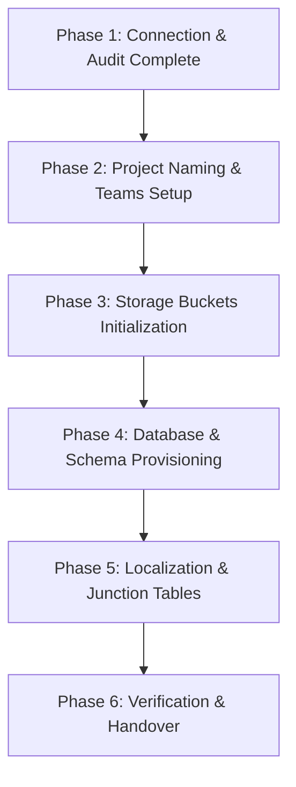

# BACKEND IMPLEMENTATION & ROLLOUT PLAN
**Project:** Museum Digital Pringgasela Selatan  
**Target Environment:** Appwrite Cloud (`6affdaa0003c416ecdb0` / `sgp`)  
**Implementation Strategy:** Non-Destructive Phased Execution  

---

## 1. Change Management & Guardrails

To strictly protect system integrity and eliminate downtime or accidental data loss:

1. **Explicit Prior Review:** Every phase requires user review and sign-off before structural modification commands are executed.
2. **Strict Non-Destructive Rule:** Commands will never invoke `delete-*` or `drop` on existing project components.
3. **Idempotency:** Resource initialization scripts check for existing IDs prior to execution.
4. **Immediate Verification:** Every resource creation is followed immediately by a verify query checking status and schema attributes.

---

## 2. Phased Rollout Schedule

### Stage 1: Team & Project Configuration
* **Action:**
  1. Update project display name to **Museum Digital Pringgasela Selatan** (retaining project ID `6affdaa0003c416ecdb0`).
  2. Create Appwrite Team `museum-admins`.
  3. Prepare initial administrator invites for `Super Admin` and `Admin Desa`.

### Stage 2: Storage Buckets Provisioning
* **Action:**
  1. Create bucket `museum-public` with allowed image/video/audio MIME types, max file size 50MB, and public read permissions.
  2. Create bucket `museum-private` with restricted staff-only permissions, max file size 250MB.
* **Verification:** Run `appwrite storage list-buckets` to verify configuration.

### Stage 3: Database & Core Table Provisioning
* **Action:**
  1. Create database `museum_digital` (ID: `museum_digital`).
  2. Provision base taxonomy and identity tables:
     * `profiles`
     * `categories`
     * `contributors`
     * `media_assets`
     * `museum_settings`
     * `audit_logs`
* **Verification:** Run `appwrite tablesdb list-tables --database-id museum_digital`.

### Stage 4: Cultural Heritage Master & Translation Tables
* **Action:**
  1. Provision primary domain tables:
     * `crafts` (Tenun Pringgasela, Batik Sasambo)
     * `craft_translations`
     * `weaving_motifs`
     * `motif_translations`
     * `cultures` (Dzikir Saman, Traditions)
     * `culture_translations`
     * `village_history`
     * `history_translations`
  2. Provision many-to-many junction tables:
     * `craft_media`
     * `motif_media`
     * `culture_media`
* **Verification:** Inspect attributes and indexes for all 17 tables.

### Stage 5: Access Permissions & Seed Data
* **Action:**
  1. Apply table-level security rules matching the `ACCESS_CONTROL_MATRIX.md`.
  2. Seed default categories (e.g. *Tenun Tradisional*, *Batik Sasambo*, *Dzikir Saman*, *Sejarah Desa*).
  3. Seed initial settings in `museum_settings`.

---

## 3. Approval Request for Execution

Phase 1 audit and architectural design deliverables are complete. Awaiting user review and authorization before executing Stage 1–5 backend modifications.
