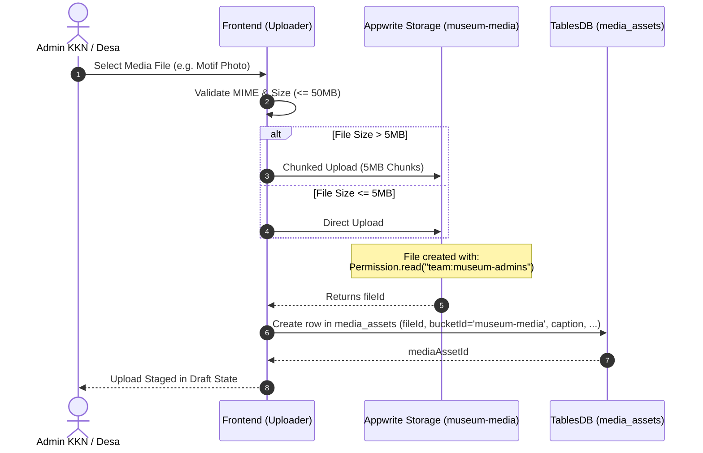

# STORAGE ARCHITECTURE SPECIFICATION
**Project:** Museum Digital Pringgasela Selatan  
**Storage Provider:** Appwrite Storage  
**Primary Bucket ID:** `museum-media`  
**Architecture Version:** 2.1.0 (Phase 2.1 Free-Tier & File-Security Hardened)  

---

## 1. Revision History & Phase 2.1 Storage Corrections

> [!IMPORTANT]
> **Phase 2.1 Storage Corrections Summary:**
> 1. **Single Bucket Consolidation (`museum-media`):** Replaced the legacy two-bucket architecture (`museum-public` / `museum-private`) with a single consolidated bucket `museum-media` to strictly respect the Appwrite Cloud Free Plan quota (exactly 1 bucket per project).
> 2. **Elimination of Global Bucket-Level Public Read:** Removed `read("any")` from the bucket ACL. A bucket-level `read("any")` completely bypasses file-level confidentiality.
> 3. **Mandatory File-Level Security (`fileSecurity: true`):** Access control is enforced on individual files via Appwrite File ACLs. Public heritage images carry `Permission.read(Role.any())`, while archival/unapproved assets carry `Permission.read(Role.team("museum-admins"))`.
> 4. **Permissions as the True Security Boundary:** Logical folder paths (e.g. `public/` and `private/`) are used strictly for human organization. True access boundaries are governed 100% by Appwrite File Security permissions.

---

## 2. Bucket Specification: `museum-media`

* **Bucket ID:** `museum-media`
* **Name:** `Museum Media & Heritage Storage`
* **Enabled:** `true`
* **File Security:** **`true` (MANDATORY)**
* **Maximum File Size:** `50,000,000` bytes (50 MB) — Aligned with Appwrite Cloud Free Plan ceiling.
* **Compression:** `none` (Media is pre-optimized or compressed via native transformations).
* **Encryption:** `true` (Server-side AES encryption for all stored files).
* **AntiVirus Scanning:** `true` (Automatic malware scanning for files $\le 20$ MB).
* **Transformations:** `true` (Enables WebP/AVIF auto-formatting, dynamic width/height thumbnail resizing via Appwrite Preview API).
* **Allowed File Extensions:**
  * Images: `jpg`, `jpeg`, `png`, `webp`, `svg`, `avif`, `tif`, `tiff`
  * Audio: `mp3`, `wav`, `aac`, `ogg`
  * Video: `mp4`, `webm`
  * Documents: `pdf`, `zip`
* **Bucket-Level ACL (Staff Only):**
  ```json
  "$permissions": [
    "create(\"team:museum-admins\")",
    "update(\"team:museum-admins/desa\")",
    "update(\"team:museum-admins/owner\")",
    "delete(\"team:museum-admins/owner\")"
  ]
  ```
  *(Notice: No `read("any")` at the bucket level! Read permissions are delegated entirely to file-level security).*

---

## 3. File-Level Access Control & Promotion Workflow

Because `fileSecurity: true` is enabled, every file uploaded inherits its individual `$permissions` array:

### 3.1. Public Media Assets (Exhibition & Public Portal)
Files ready for public display (photographs of woven cloths, motif details, Saman performance audio):
* **File Permissions:**
  ```typescript
  [
    Permission.read(Role.any()), // Public CDN delivery enabled
    Permission.update(Role.team("museum-admins", "desa")),
    Permission.delete(Role.team("museum-admins", "owner"))
  ]
  ```

### 3.2. Private / Draft Media Assets (Archival & Pre-Publication)
Restricted documents (unverified field recordings, researcher notes, grant contracts, raw master audio):
* **File Permissions:**
  ```typescript
  [
    Permission.read(Role.team("museum-admins")), // Blocked for public visitors
    Permission.update(Role.team("museum-admins", "desa")),
    Permission.delete(Role.team("museum-admins", "owner"))
  ]
  ```

### 3.3. Promotion Lifecycle: From Draft to Published Media
When an administrator approves a draft heritage entry:
1. The backend or Server Action calls `storage.updateFile()` to append `Permission.read(Role.any())` to the file permissions.
2. The associated record in `media_assets` updates `isPublished = true`.
3. If an entry is unpublished or archived, `Permission.read(Role.any())` is removed, instantly cutting off public CDN access.

---

## 4. Logical Folder Hierarchy & Storage Paths

Appwrite Storage stores files with unique IDs (`fileId`). To maintain clean organizational naming, files are uploaded with structured virtual path prefixes in their filename or registered in `media_assets`:

```text
museum-media/
├── public/
│   ├── crafts/           # High-quality photography of finished textiles
│   ├── motifs/           # Pattern details, macro photos, vector SVG diagrams
│   ├── cultures/         # Dzikir Saman ceremony photos, curated audio chants
│   └── history/          # Historical village photos, founder portraits
└── private/
    ├── drafts/           # Student KKN raw uploads pending verification
    ├── archives/         # High-resolution TIFF scans, historical manuscripts
    └── administrative/   # Village board agreements, research ethics forms
```

> [!WARNING]
> **Security Guardrail:** An attacker cannot access a file simply by guessing a path or file ID. Even if a visitor knows the exact file ID for `private/archives/manuscript-01.pdf`, Appwrite's storage engine enforces the file's ACL and rejects the request with `HTTP 401 Unauthorized`.

---

## 5. Upload Lifecycle & Integration



### TypeScript SDK Upload Implementation
```typescript
import { Client, Storage, ID, Permission, Role } from 'appwrite';

const client = new Client()
  .setEndpoint('https://sgp.cloud.appwrite.io/v1')
  .setProject('6affdaa0003c416ecdb0');

const storage = new Storage(client);

// Uploading draft heritage media (private by default)
export const uploadHeritageMedia = async (
  file: File, 
  isPublic: boolean,
  onProgress: (percent: number) => void
) => {
  const permissions = isPublic 
    ? [
        Permission.read(Role.any()),
        Permission.update(Role.team("museum-admins", "desa")),
        Permission.delete(Role.team("museum-admins", "owner"))
      ]
    : [
        Permission.read(Role.team("museum-admins")),
        Permission.update(Role.team("museum-admins", "desa")),
        Permission.delete(Role.team("museum-admins", "owner"))
      ];

  return await storage.createFile(
    'museum-media',
    ID.unique(),
    file,
    permissions,
    (progress) => {
      onProgress(Math.round((progress.progress / progress.total) * 100));
    }
  );
};
```
